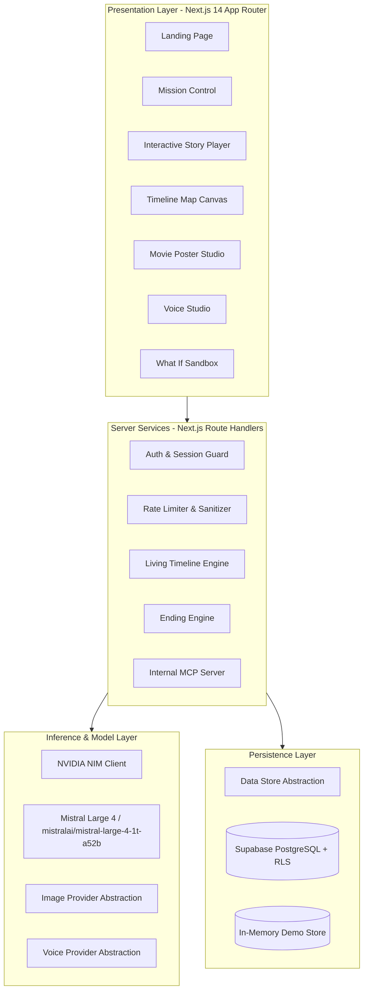

# TIMELOOP AI – Architecture Documentation

## 1. System Overview

TIMELOOP AI is engineered as an enterprise-grade, stateful interactive story and entertainment platform. It decouples the visual presentation layer from the narrative state machine and AI inference orchestration.

---

## 2. The Living Timeline Engine

### State Machine Definition
Every active story maintains a state vector:
$$\mathcal{S} = \langle E, C, S_n, P, \mathcal{R}, \mathcal{F}, \Omega, \mathcal{H}, \mathcal{B} \rangle$$
Where:
- $E$: Current Time Era
- $C$: Chapter number (1...8)
- $S_n$: Scene number within chapter
- $P$: Protagonist profile
- $\mathcal{R}$: Faction / Character relationship affinities ($0 \le r_i \le 100$)
- $\mathcal{F}$: World and narrative boolean flags
- $\Omega$: Resource reserves (influence, reputation, temporal charge)
- $\mathcal{H}$: Chronological decision history (scene id, choice id, text, timestamp)
- $\mathcal{B}$: Active timeline branch identifier

### Decision Processing Pipeline
1. **Validation**: Check choice ownership and belonging to active scene.
2. **Context Compilation**: Format compact summary + relationship snapshot (avoids context bloat).
3. **Inference**: Invoke NVIDIA NIM with structured JSON instructions.
4. **Backend Authority**: Clamp state mutations between 0 and 100, enforce permitted flag mutations.
5. **Branch Forking**: If decision was made from a past checkpoint, spawn new branch `branch-[timestamp]` rather than overwriting canonical history.
6. **Ending Eligibility Check**: Deterministically evaluate unlockable endings.

---

## 3. Model Context Protocol (MCP) Integration

The internal MCP server uses `@modelcontextprotocol/sdk/server/mcp.js`.

### The 12 Tools
1. `get_era_details`: Fetch historical context and suggested roles.
2. `get_character_profile`: Retrieve character psychological matrix and attributes.
3. `create_story`: Initialize a new story narrative.
4. `get_story_state`: Retrieve current timeline state and relationships.
5. `save_story_scene`: Persist generated narrative and choices.
6. `save_story_choice`: Register a player decision node.
7. `update_timeline_state`: Mutate relationship scores and story flags.
8. `generate_scene_image`: Produce visual keyframe artwork.
9. `generate_movie_poster`: Create theatrical teaser poster prompt & artwork.
10. `get_available_endings`: Query unlockable story endings.
11. `save_story_ending`: Record achieved ending in player vault.
12. `get_user_library`: Fetch player stories, characters, and bookmarks.

### Security
- Injected backend user identity ensures users cannot query or alter another user's stories.
- Zod runtime schema validation prevents prompt injection from passing malformed payloads.

---

## 4. Error Handling & Resilience
- **Exponential Backoff**: Automatic retry for HTTP 429 and 5xx responses from NVIDIA NIM.
- **Fail-safe Image Fallback**: When external image provider credentials are absent, high-resolution curated preview artwork is served with clear honest labels.
- **Dual-mode Data Store**: Connects to live Supabase with full RLS when credentials are provided, or seamlessly operates via the local store for standalone dev/demo execution.
