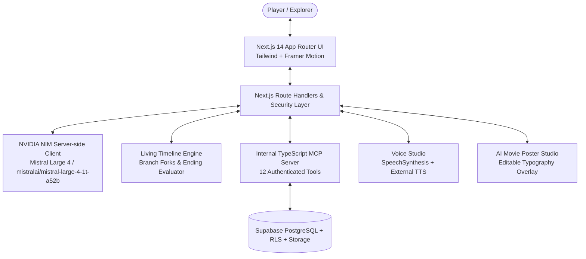

# TIMELOOP AI – ENTERTAINMENT EDITION

> **Don't Just Watch History. Become Part of It.**  
> *NVIDIA NIM + MCP + Generative AI + Living Timeline Engine*

---

## 🌟 Executive Summary

**TIMELOOP AI – Entertainment Edition** is a full-stack, AI-powered interactive cinematic entertainment platform. It transports users into the roles of protagonists across 8 rich historical and speculative timelines. Every decision made by the player is evaluated by the **Living Timeline Engine** and processed through **NVIDIA NIM** (Mistral Large 4) and an authenticated internal **Model Context Protocol (MCP)** server.

Unlike standard chatbot text-adventures, TIMELOOP AI enforces stateful narrative consequences: character relationship affinities (0–100), hidden world flags, and resource budgets determine future plot twists, branching alternate realities, and unlockable ending eligibility.

---

## 🚀 Key Innovations & Architecture



### 1. Living Timeline Engine (Core USP)
- **Branch Management**: Players can branch into alternate timelines from previous decision checkpoints without silently overwriting the original canonical path.
- **Backend Authority**: Narrative state changes are strictly clamped and validated in server-side logic before persistence.
- **Multiple Endings**: Deterministic evaluation of **Hero**, **Villain**, **Mystery**, **Tragic**, **Secret**, and **Alternate Timeline** endings.

### 2. NVIDIA NIM Integration
- **Endpoint**: `https://integrate.api.nvidia.com/v1/chat/completions`
- **Primary Model**: `mistralai/mistral-large-4-1t-a52b` (Mistral Large 4)
- **Production Features**: Exponential backoff retry (up to 3 attempts), request timeouts, token usage tracking, error classification, and runtime Zod validation.

### 3. Model Context Protocol (MCP) Server
- Implemented with the official `@modelcontextprotocol/sdk`.
- 12 registered tools covering era lore, character profiles, story scenes, timeline states, image generation, ending evaluation, and personal library retrieval.
- Standalone stdio transport runner (`npm run mcp:server`) for external host connectivity.

### 4. 8 Rich Time Eras
- **Ancient India** (Vedic & Mauryan Epoch)
- **Mughal Era** (16th–17th Century)
- **Ancient Egypt** (New Kingdom)
- **Medieval Kingdom** (12th Century Europe)
- **World War Era** (1940s Espionage)
- **Neo-Kowloon 2099** (Cyberpunk Future)
- **Aethelgard Stellar Imperium** (Year 3420)
- **The Shattered Realms of Eldoria** (Fantasy Universe)

---

## 🛠️ Quick Start & Setup

### Prerequisites
- Node.js 18+ (tested on v24.16.0)
- npm 9+

### 1. Clone & Install
```bash
git clone <repo-url>
cd "TIMELOOP AI"
npm install
```

### 2. Configure Environment Variables
Copy `.env.example` to `.env.local`:
```bash
cp .env.example .env.local
```
Fill in your credentials:
```env
# NVIDIA NIM API (Primary LLM)
NVIDIA_API_KEY=nvapi-your-key-here
NVIDIA_BASE_URL=https://integrate.api.nvidia.com/v1
NVIDIA_MODEL=mistralai/mistral-large-4-1t-a52b

# Supabase (Database, Auth & Storage)
NEXT_PUBLIC_SUPABASE_URL=https://your-project.supabase.co
NEXT_PUBLIC_SUPABASE_ANON_KEY=your-anon-key
SUPABASE_SERVICE_ROLE_KEY=your-service-role-key

# Optional External Providers
IMAGE_PROVIDER_API_KEY=
VOICE_PROVIDER_API_KEY=
```
*(Note: If no API keys are provided initially, TIMELOOP AI runs in offline evaluation mode with high-fidelity deterministic responses, curated preview artwork, and browser SpeechSynthesis voice narration).*

### 3. Database Migration & Seed
Apply the Supabase migrations in `supabase/migrations/`:
```bash
# Apply SQL migrations to your Supabase project:
# 1. supabase/migrations/20261120000000_init_timeloop_schema.sql
# 2. supabase/migrations/20261120000001_rls_and_storage.sql
# 3. supabase/seed.sql
npm run seed
```

### 4. Run Development Server
```bash
npm run dev
```
Open [http://localhost:3000](http://localhost:3000) to begin your adventure.

### 5. Run Standalone MCP Server
```bash
npm run mcp:server
```

---

## 🧪 Testing Suite

Execute the unit and integration test suite:
```bash
npm run test
```
Run end-to-end user journey tests with Playwright:
```bash
npm run test:e2e
```

---

## 📁 Repository Structure

```
├── .env.example                # Environment configuration template
├── package.json
├── tsconfig.json
├── tailwind.config.ts          # Cinematic sci-fi theme tokens
├── vitest.config.ts            # Unit & integration test configuration
├── playwright.config.ts        # E2E test configuration
├── supabase/
│   ├── migrations/             # PostgreSQL migrations & RLS policies
│   └── seed.sql                # Seed data for 8 initial eras
├── src/
│   ├── app/                    # 19 Next.js App Router pages & API routes
│   │   ├── api/ai/             # NVIDIA NIM inference & generation endpoints
│   │   ├── api/stories/        # Story and decision endpoints
│   │   ├── api/mcp/            # Authenticated MCP tool execution
│   │   ├── eras/               # Time era catalog and lore pages
│   │   ├── story-player/       # Interactive story player HUD
│   │   ├── timeline-map/       # Interactive branching tree visualizer
│   │   ├── poster-studio/      # AI Movie Poster Studio
│   │   ├── voice-studio/       # Chrono-Voice Studio
│   │   └── what-if/            # What If Universe generator
│   ├── lib/
│   │   ├── ai/                 # NVIDIA client, prompts, image & voice providers
│   │   ├── engine/             # Living Timeline Engine & Ending Evaluator
│   │   ├── mcp/                # Official MCP SDK server & 12 tool schemas
│   │   └── supabase/           # Client, Server, and Dual-Mode Data Store
│   └── components/             # Reusable UI & Story HUD components
└── tests/
    ├── unit/                   # Vitest unit & integration test suites
    └── e2e/                    # Playwright end-to-end journey test
```

---

## 📄 License
MIT License. Developed as a production-grade Capstone for B.Tech AI/ML.
